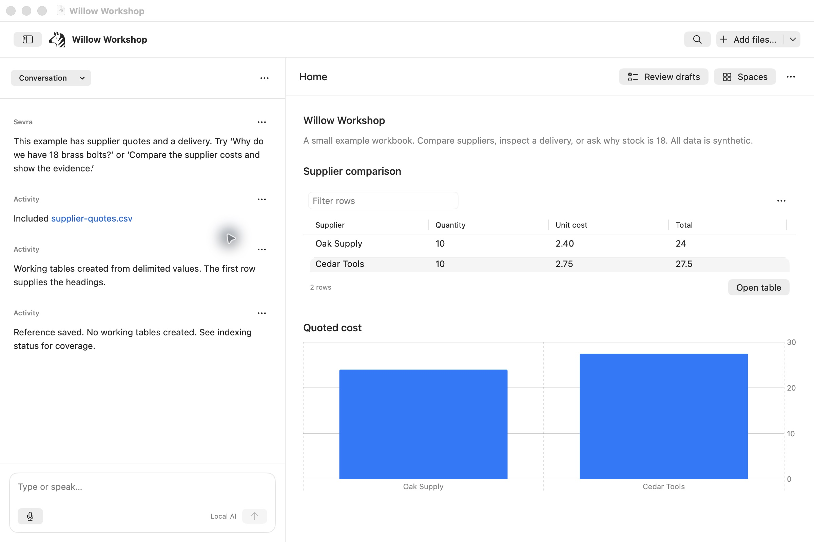

# Sevra

**A spreadsheet you run by talking to it, with AI on your Mac.**

Tell Sevra what you need in chat. It keeps your business data in real tables,
makes the changes you ask for and builds the views you use to see and work with
it: tables, charts, totals, buttons and small apps, on your Home and in views
you come back to. The AI runs on your Mac, and your files stay there.

[Website](https://www.sevrahq.com) ·
[Get started](#try-sevra-on-your-mac) ·
[Example walkthrough](db/records/operations/build-and-run.md#supplier-comparison-walkthrough)

Free and open source under the [MIT license](LICENSE). The current Mac preview
is built from source. A notarized installer is not yet available.



*Inside Sevra. Sample data shown.*

## How it works

- **Ask in chat.** Add or fix rows, create a table from a list, total by
  category, or bring in a CSV, PDF or Excel file. Each change is saved with
  history and can be undone.
- **See it in views.** Ask for a view and Sevra builds it from your tables:
  tables, bar and line charts, totals and counts, buttons that run a saved
  action, forms and small native apps. Home is your own working overview, and
  you change it the same way, by asking.
- **Sevra keeps the database.** Your data lives in typed tables in the
  workbook. Numbers come from queries over those tables, not from the AI's
  guess, and answers cite the rows and documents they used.
- **Local AI, including offline.** The model runs on your Mac. Your documents
  are not sent to a hosted AI model, and you can work offline after setup and
  the model download. The app has no telemetry.
- **A workbook you own.** Included files, tables, views, saved tools and app
  code stay together in a workbook you can copy or export. Permission to run an
  app is approved on each Mac and does not travel with the copy.

Things you can ask, from the requests Sevra is tested on:

- “cedar tools is 2.50 a unit now, fix it”
- “Create a table named Reorder levels with the columns Item and Level from
  this list: Brass bolts, 12 / Steel washers, 40 / Hex nuts, 25”
- “Total the line items of invoice 7781 by category and save the totals as a
  table named Invoice 7781 totals.”
- “Create a view named Purchasing that shows the Supplier comparison table and
  a chart of total by supplier.”
- “Add a button to my Home for logging a customer visit.”
- “Do not change anything. What would the Cedar Tools total be if its unit cost
  were 2.60 instead of 2.75?”

The AI can misunderstand a request or miss a document, so check the views and
answers it makes, especially before acting on them.

<a id="try-the-native-mvp-preview"></a>

## Try Sevra on your Mac

### Requirements

- Apple M3 or newer and macOS 26.4 or later.
- Swift 6.3, Git, Python 3 for build tooling, and Rust 1.96.0 through rustup.
- Network access for the initial build, dependencies and model download.
- **21.48 GB for model weights**, plus build and runtime working space.

The current test Mac has **48 GB of unified memory**. Other memory
configurations have not been validated. Python is used for the build, not for
running the installed model.

### Install from source

For a fresh checkout:

```sh
git clone https://github.com/carloslfu/sevra-app.git
cd sevra-app
rustup toolchain install 1.96.0 --profile minimal
bash scripts/install.sh
open "$HOME/Applications/Sevra.app"
```

If you already have a checkout, use it. Quit the running app before updating.
The installer builds the native app and installs its matching CLI at
`~/.local/bin/sevra`. It refuses to replace an unrelated app or CLI. Source
builds are locally ad-hoc signed.

Use `~/.local/bin/sevra version` to check the installed workbook CLI if another
program named `sevra` appears earlier in your shell's PATH. See
[Build and run](db/records/operations/build-and-run.md) for build-only commands,
resource verification, updates and uninstall instructions.

Maintainers can build and test a standalone DMG and Sparkle updates using the
[macOS release runbook](db/records/plans/macos-installer-and-updates.md#rehearse-a-release-locally).

### Set up local AI

In Settings, choose **Download model**, or **Verify model files** when files are
already present. To reuse compatible Qwen3.6 35B A3B 4-bit weights with DFlash 2,
expand **Model files and storage > Use existing model files…**.

Once the model is downloaded, quit Sevra and run the installer once more:

```sh
bash scripts/install.sh
```

This reads the start that every chat shares once, with the model, and seals it in
the app, so chat does not read it again each time the model starts. Chat stays
unavailable until then, and the app says so. Run the installer again after you
update the source.

Models stay outside your workbooks. Import, search, tables, calculations and
saved results also work without setting up AI.

### Your first workbook

1. Choose **Add files** on the start window and select the
   [sample CSV and PDF](examples). Sevra makes the workbook in `~/Sevra Workbooks`.
   The files are included and indexed.
2. Ask Sevra to compare the quotes, including shipping. Open the cited quotation
   to check the source and inputs. Missing tax information stays marked as unknown.
3. Ask for a view that shows the comparison table and a chart of the totals.
4. Change a quantity or price in chat and watch the view update. Try Undo, then
   close and reopen the workbook.
5. Export and reopen a portable copy to keep the files, tables and views together.

The [supplier comparison walkthrough](db/records/operations/build-and-run.md#supplier-comparison-walkthrough)
has the exact steps. Focused requests work best.

## Build small apps

<a id="build-a-native-mini-app"></a>


Add an **.xlsx or .xlsm** file and describe how you use it. Sevra keeps the
original and can use its tables and supported calculations to build a small
native app. You can also choose **Just use the tables** without a model.
The [Excel guide](db/records/specs/single-excel-import.md) explains the process.

For a new tool, describe its fields, actions and tables. App generation includes
checks with synthetic inputs and a model review before saving. Review the app's
data access before enabling it. Each changed version needs approval again.
See the [authoring guide](db/records/specs/local-model-native-apps.md).

You can also import the [Inventory, Jobs and Visual Planner examples](examples/apps)
with **Workbook > Add Native App…**. Their interfaces use native controls.
App code runs in a sandboxed worker with access to the data you approve.

Use the controls or ask in chat: “Add Pencils with quantity 3,” “Change it to 5,”
or “Undo that change.” Apps support Undo and Redo for the latest saved change,
including after reopening. A new saved change replaces the previous Redo.
See the [chat operation guide](db/records/specs/chat-primary-operation.md).

**Test generated apps with your own cases before using them for business.**
Generation can fail or take minutes. Automated checks help find problems, but
cannot establish that an app handles every situation you need.

Excel support also has limits. Original macros never execute. Sevra can attempt
to recreate readable macro logic as local calculations and actions, then compare
results with supplied originals. Those comparisons cover only the provided cases.
External services, unreadable sources, exact Excel rendering and automatic formula
extension to inserted rows remain limits. See the
[Excel conversion details](db/records/specs/excel-application-reconstruction.md)
and [recorded trials](db/records/plans/fresh-excel-batches.md).

## Development and current limits

Use copies of your files while evaluating Sevra, keep backups and check important
results. The [current handoff](db/records/operations/agent-handoff.md) and
[verification register](db/records/operations/implementation.md) record what has
been tested, known failures and work still in progress. Production signing,
notarization and broader hardware testing remain unfinished.

Development formats and interfaces may change before the first notarized,
production-ready 1.0 release. Current-format history and originals remain
protected. See the [compatibility policy](db/records/specs/distribution.md#pre-10-compatibility-policy).

The app uses SwiftUI, AppKit and SQLite, with a shared Swift core and CLI.
Local inference runs through the native Splash C++/Metal engine. A `.sevra`
workbook contains its database and ordinary included asset files. A `.sevraz`
file is a portable copy. Cloud sync is not part of the current app.

For contributors:

- [Build, run and verification commands](db/records/operations/build-and-run.md)
- [Native UI Catalog](db/records/operations/native-ui-catalog.md) for components, states and replayable workflows
- [Native app SDK](sdk/README.md) and [architecture](db/records/specs/programmable-native-engine.md)
- [Visuals plan and verification](db/records/plans/rich-native-visuals.md)
- [Inference configuration and qualification](db/records/operations/inference-context-execution.md)
- [Repository instructions](AGENTS.md) and [specification store](db/DB.md)

The native app is developed in this repository. [sevrahq.com](https://www.sevrahq.com)
is its marketing website.

Report problems in [GitHub Issues](https://github.com/carloslfu/sevra-app/issues).
Include the app version, reproduction steps and a small synthetic example.

## License

Sevra's source is available under the [MIT license](LICENSE). Third-party
components and model weights have their own licenses.
